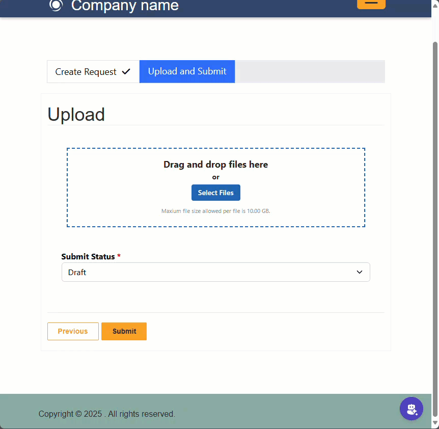

# **Azure Blob Storage File Manager for Power Pages**



## Introduction

This document provides installation steps, setup guidance, and configuration details for the PCF component used for handling file uploads via the Azure File API within Power Pages. This component allows users to upload, download, and manage files stored in an Azure Blob Storage.

Using Azure Blob Storage for file management in Power Pages offers several advantages over other storage solutions like SharePoint:

- **Increased File Size Limit**: SharePoint has a maximum file size limit of 50MB per file for Power Pages. In contrast, Azure Blob Storage supports files up to 10GB per file, making it ideal for storing large files such as videos, high-resolution images, and large datasets.
- **Scalability**: Azure Blob Storage is designed to handle massive amounts of unstructured data and can scale to meet your storage needs without compromising performance.
- **Cost-Effective**: Azure Blob Storage offers a pay-as-you-go pricing model, allowing you to only pay for the storage you use. This can be more cost-effective compared to other storage solutions.
- **High Availability and Durability**: Azure Blob Storage provides high availability and durability with multiple redundancy options, ensuring your data is safe and accessible even in the event of hardware failures.
- **Security**: Azure Blob Storage offers advanced security features, including encryption at rest and in transit, role-based access control (RBAC), and integration with Azure Active Directory for authentication and authorization.
- **Global Reach**: With data centers located around the world, Azure Blob Storage allows you to store your data close to your users, reducing latency and improving access speeds.
- **Integration with Azure Services**: Azure Blob Storage seamlessly integrates with other Azure services, such as Azure Functions, Azure Logic Apps, and Azure Data Factory, enabling you to build powerful workflows and data processing pipelines.
- **Developer-Friendly**: Azure Blob Storage provides a rich set of APIs and SDKs for various programming languages, making it easy for developers to integrate and manage storage within their applications.

The techniques and methods used in this PCF component were inspired by the article ["Configure the Web API for Azure Blob Storage in Power Pages"](https://learn.microsoft.com/en-us/power-pages/configure/webapi-azure-blob) from Microsoft Learn. This article provides detailed guidance on configuring the Web API for Azure Blob Storage within Power Pages, which served as a valuable resource during the development of this component.

## Features

- **Multiple File Uploads:** Supports both single and multiple file uploads via drag and drop or file selection.
- **Configurable Limits:** File size, number of files, allowed file types, and MIME types can be configured via component properties and site settings.
- **Responsive & Adaptive UI:** Automatically adapts to various screen sizes including mobile, with adjustable grid heights.
- **Edit Form Compatibility:** Currently supports file uploads on Edit forms, with plans to extend functionality to Create forms in the future.
- **Progress Indicators:** Displays real-time upload progress with progress bars and percentage updates.
- **Error Handling:** Clear modal alerts and error messages for issues like unsupported file types and file size limits.
- **Security Compliance:** This control uses the Power Page file API to ensure that all requests conform to Power Pages web role security.
- **Theming Support:** Light and dark Fluent UI themes generated from a single brand colour, configurable per form or per link.
- **Host Page Notifications:** Publishes upload and delete activity to the page so it can show an overlay or block submit. See below.
- **Transfer Protection:** A file dropped outside the drop zone cannot navigate the browser away from the form, and closing the tab mid transfer prompts first.
- **Dynamic Grid & Sorting:** Detailed grid view with sorting, selection, and a footer showing total and selected file counts.
- **Multi-Language Support:** Provides translations for English (en), Spanish (es), French (fr), German (de), Chinese (zh), Japanese (ja), Korean (ko), Italian (it), Dutch (nl), and Portuguese (pt).
- **Accessible Interaction:** Drag and drop, a file selection button, and full keyboard operation of the drop zone, with aria labels throughout.

## Installation

To install the PCF component, follow these steps using the **Maker Portal**:

- Open **Power Apps Maker Portal** (`https://make.powerapps.com`).
- Navigate to **Solutions** in the left-hand menu.
- Click **Import Solution**.
- Select the solution file for the PCF component (`.zip` file) and click **Next**.
- Review the dependencies and required permissions.
- Click **Import** and wait for the installation process to complete.
- Once installed, the PCF component will be available for use in your Power Apps environment.

Ensure that you have the appropriate **permissions** to install solutions and manage components within your Power Apps environment.

> **Import the managed solution unless you are actively developing the control.** If a managed
> version of this control is already installed in an environment, do **not** import an
> unmanaged build over it. Doing so creates an unmanaged layer on the control that deleting
> the solution does not remove, that importing an older version cannot roll back, and that
> re-importing the managed solution does not displace. Recovering from it has required
> restoring the environment from backup. `pac pcf push` has the same effect, because it also
> imports unmanaged.

## Portal Setup

This guide demonstrates how to implement the Azure File API. These steps empower your website's users or visitors to view, edit, create, and delete attachments stored in Azure.

### Note

- Azure File size of up to 10 GB is supported.
- You can change the column names or use a different table while following the steps in this example.
- These APIs only work for records already created. Attachments uploaded using these APIs will be linked to that record.
- These APIs will perform multiple updates on the note (Annotation) entity as files are uploaded in chunks.

### Prerequisites

This walk-through depends on a custom table named **File Test**. You can create a custom table with the same name or choose to use another table.

### Create Site Settings

Before you can use the Power Pages Azure File API, you have to enable the required site settings using the Portal Management app.

1. Open the **Portal Management** app.

2. Select **Site Settings** in the left pane.

3. Click **New** and enter the following values:

   - **Name:** `Site/FileManagement/EnableWebAPI`
   - **Website:** Select your website record.
   - **Value:** `true`
   - Click **Save & Close**.

4. Add the following additional site settings:

| Site Setting Name                                | Default Value               | Description                          | Mandatory |
| ------------------------------------------------ | --------------------------- | ------------------------------------ | --------- |
| Site/FileManagement/EnableWebAPI                 | true                        | Enables the file management Web API  | Yes       |
| Site/FileManagement/BlobStorageAccountName       | *Your Storage Account Name* | Storage Account Name                 | Yes       |
| Site/FileManagement/BlobStorageContainerName     | *Your Container Name*       | Container Name                       | Yes       |
| Site/FileManagement/SupportedFileType            | \*                          | Comma separated file types, each with a leading dot, for example `.jpeg,.jpg` | Yes       |
| Site/FileManagement/SupportedMimeType            | *\*/\**                     | **Semicolon** separated MIME types    | Yes       |
| Site/FileManagement/MaxFileSize                  | 1048576 (1 GB)              | Max file size in KB. Maximum is 10485760 (10 GB)                  | No        |
| Site/FileManagement/DownloadViaSASUri            | True                        | Whether to use SAS URI for downloads | No        |
| Site/FileManagement/DownloadSASUriExpiryTimeSpan | 00:10:00                    | SAS URI expiry time span             | No        |
| Site/FileManagement/DownloadChunkSizeInKB        | 4096 (4 MB)                 | Chunk size for downloads             | No        |

5. Add these extra site settings to enable Web API for annotations (notes):

| Site Setting Name         | Value |
| ------------------------- | ----- |
| Webapi/annotation/enabled | true  |
| Webapi/annotation/fields  | \*    |

### Configure Permissions

To allow users to use the Azure File API feature, configure permissions for web roles and table access.

#### Create a Web Role

1. Open the **Portal Management** app.
2. Select **Web Roles** in the left pane.
3. Click **New** and enter:
   - **Name:** `Azure File API User` (or another relevant name).
   - **Website:** Select your website record.
   - Click **Save**.

#### Create Table Permissions

1. Open **Power Pages Design Studio**.
2. Navigate to **Security > Table Permissions**.
3. Click **New Permission** and configure:
   - **Name:** `File Test Table Permission`.
   - **Table Name:** `File Test (cr463_filetest)`.
   - **Access Type:** `Global Access`.
   - **Privileges:** `Read, Append to`.
   - **Web Role:** Select the web role created earlier.
   - Click **Save**.
4. Create another table permission for **Notes (Annotations)** with `Write, Read, Create, Append` privileges and assign the same web role.

#### Assign Web Roles to Users

1. Open **Portal Management**.
2. Select **Contacts** in the left pane.
3. Choose a contact and navigate to **Related > Web Roles**.
4. Click **Add Existing Web Role** and select `Azure File API User`.
5. Click **Add**, then **Save & Close**.

### Add Role-Based Permissions for Microsoft Entra (Azure AD)

1. Sign in to Azure.
2. Navigate to the **Resource Group** that contains the storage account.
3. Select **Access Control (IAM) > Add > Add Role Assignment**.
4. Choose the **Reader Role** and click **Next**.
5. Select **User, Group, or Service Principal**, then **+ Select Members**.
6. Search for your Power Pages site name and select it. The application is named `Portals-<site name>`.
7. Click **Select**, then **Review + Assign**.
8. Repeat the process for **Storage Blob Data Contributor** role.

## Adding PCF to Form

To use the PCF component on a form, the entity must have **Attachments enabled**, and the component must be added to a **Single Line Text field**.

### Adding the PCF Component to an Entity Form

- Open **Power Apps Design Studio** and navigate to the **Data workspace**.
- Select the desired entity where you want to use the PCF component.
- Select **Forms** and open the form where the component will be added.
- Add a new **Single Line Text** field (or select an existing one).
- Position the field on the form.
- With the field selected, click **+ Component** and choose the PCF component from the list.
- Configure the component settings as needed.
- Click **Done**.
- Save and **Publish** the form.

### Configuring the Form Component on a Webpage

- Navigate to the **Pages workspace** in Power Pages.
- Select or create a page where the form is displayed.
- Locate the form and find the field where the PCF component was added.
- If the field displays a message like *Enable custom component to see this field in preview*, select the field and click **Edit field**.
- Enable the **Custom Component** option.
- Click **OK**.
- Save and publish the page.
- When previewing the site, the PCF component should now be visible on the form.

## PCF Settings

The following settings configure the PCF component's behavior. Keep in mind that these settings only apply to the PCF component itself. If the site settings (such as `Site/FileManagement/MaxFileSize` or `Site/FileManagement/SupportedFileType`) are more restrictive than the PCF settings, the upload will fail accordingly.

### Available Properties

| Property             | Description                                                                                                                                                       | Type              | Default Value       |
| -------------------- | ----------------------------------------------------------------------------------------------------------------------------------------------------------------- | ----------------- | ------------------- |
| `allowMultipleFiles` | Allows users to upload multiple files.                                                                                                                            | `TwoOptions`      | `true`              |
| `allowedFileTypes`   | File extensions separated by a comma. A leading dot is optional, so `png, jpg` and `.png, .jpg` behave identically. Case insensitive. All types allowed if left empty. | `SingleLine.Text` | *All types allowed* |
| `allowedMimeTypes`   | MIME types separated by a comma (for example `image/png, application/pdf`). Wildcards are supported, so `image/*` matches any image and `*/*` matches everything. All types allowed if left empty. | `SingleLine.Text` | *All types allowed* |
| `displayAllFiles`    | Display all files in the grid.                                                                                                                                    | `TwoOptions`      | `true`              |
| `uploadSizeLimitKB`  | Maximum upload size per file in KB. (Max: `10485760` KB or `10 GB`)                                                                                               | `Whole.None`      | `10485760` KB       |
| `maxNumberOfFiles`   | Enter the maximum number of files a user can upload.                                                                                                              | `Whole.None`      | `0`                 |
| `maxGridHeight`      | Maximum grid height in pixels. Set to `0` for unlimited height.                                                                                                   | `Whole.None`      | `0`                 |
| `themeColor`         | Theme color for the component.                                                                                                                                    | `SingleLine.Text` | `#0F6CBD`           |
| `themeDarkMode`      | Enable dark mode for the component.                                                                                                                               | `TwoOptions`      | `false`             |
| `language`           | Available languages for the component. Options: en, es, fr, de, zh, ja, ko, it, nl, pt.                                                                            | `Enum`            | `en`                |
| `layout`             | Component layout option. Options: Horizontal, Vertical.                                                                                                           | `Enum`            | `Vertical`          |


### What the bound field contains

The control is bound to a single line text field and writes the **number of files** currently
attached to the record into it, clearing it when there are none.

That makes the bound field useful for validation. Mark it **required** on the form and the
user cannot submit until at least one file is attached, with no custom script.

The value is a count. It is not a file name or an id, so do not parse it as one.

### Overriding the theme from the URL

`themeColor` and `themeDarkMode` can also be set with a query string parameter, which is
useful when one page needs a different theme from the form default and you do not want to
edit and publish the form to get it.

| Parameter        | Accepts                                   | Example                 |
| ---------------- | ----------------------------------------- | ----------------------- |
| `themeColor`     | A hex colour, 3 or 6 digits, `#` optional | `themeColor=%23107C10`  |
| `themeDarkMode`  | `true`, `false`, `1`, `0`                 | `themeDarkMode=true`    |

```
https://<your-site>/<your-page>/?themeDarkMode=true&themeColor=E3008C
```

Precedence is the URL parameter first, then the property configured on the form, then the
default.

Remember to URL encode the `#` as `%23` if you include it. `themeColor=E3008C` without the
`#` works too.

**Only a plain hex colour is accepted.** Named colours such as `red`, and any functional
syntax such as `rgb(...)`, are rejected, because the value ends up in generated CSS and the
parameter is something anyone can put in a link. A value that fails validation is ignored and
the control falls back to the configured property, so a bad link renders the default theme
rather than breaking the control.

The theme is applied when the control loads, so changing the parameter needs a page reload.

### Behavior Considerations

- Both lists must pass. If you set `allowedFileTypes` **and** `allowedMimeTypes`, a file has
  to satisfy both. A file whose MIME type the browser cannot determine reports an empty type
  and will therefore fail a configured MIME list, so prefer extensions alone for formats such
  as `.bin`.
- If the **site settings** for file size, allowed file types, or MIME types are **more restrictive** than the PCF settings, uploads will **fail** due to site-level restrictions.
- Ensure the entity where this PCF is applied has **Attachments enabled** to support file uploads.
- The component should be added to a **Single Line Text field** in Power Apps for proper integration.
- The `language` property does **not** follow the browser or the signed in user's language. It
  is whatever the form is configured with, defaulting to `en`.

## Troubleshooting

| What you see | Likely cause |
| ------------ | ------------ |
| "This record hasn't been created yet. To enable file upload, create this record" | The control is on a **Create** form. The Azure File API can only attach to a record that already exists, so place it on an Edit form or a later step of a multi step form. |
| "Enable custom component to see this field in preview" | The Custom Component option is not enabled for that field on that page. See [Configuring the Form Component on a Webpage](#configuring-the-form-component-on-a-webpage). |
| The control renders but never lists any files | Table permissions for the Note (annotation) table are missing, or the web role is not assigned to the signed in contact. |
| Uploads rejected before any network call | This is the control's own `allowedFileTypes`, `allowedMimeTypes`, `uploadSizeLimitKB` or `maxNumberOfFiles` validation. The message names which limit was hit. |
| Upload fails with **400**, code `FU00004`, `FU00016` or `FU00021` | The **site settings** rejected the type. `Site/FileManagement/SupportedFileType` and `SupportedMimeType` are enforced separately from the control's properties, and are frequently stricter. |
| Upload fails with **400**, code `FU00007` or `FU00022` | `BlobStorageAccountName` or `BlobStorageContainerName` is wrong or missing. |
| Upload fails with **403**, code `FU00003` | A Power Pages table permission problem, not an Azure one. |
| Upload fails with **403**, code `FU00018` | The Entra application is missing the **Storage Blob Data Contributor** role on the storage account. |
| Upload fails with **403**, code `FU00011` | IP restrictions are enabled on the storage account. |
| Files upload but downloads fail | Check `Site/FileManagement/DownloadViaSASUri` and the **Reader** role assignment on the resource group. |
| The control renders light on a dark site | The theme is not auto detected. Set `themeDarkMode` on the form, or append `themeDarkMode=true` to the page URL. |

The full list of Azure File API error codes is in the Microsoft Learn article linked in the
[Introduction](#introduction).

## Built-in Transfer Protection

Two protections are always on. Nothing needs configuring, and they are inert unless a file
drag or a live transfer is present.

- **A stray drop cannot navigate the page away.** Dropping a file anywhere outside the drop
  zone would normally make the browser leave the page to open that file, which on a multi
  step form loses everything the user has entered. Files dropped outside the zone are now
  ignored instead. Drags that do not carry files are untouched, so other drop targets on the
  page still work.
- **Closing the tab during a transfer prompts first.** The browser shows its own confirmation
  while any upload or delete is running, and stays silent otherwise.

Because of the second one, the `beforeunload` snippets further down are **optional**. They
are kept for reference and are harmless if you add them anyway.

## Notifying the Page During File Operations

The control tells the host page whenever an upload or delete is in flight, so the page can
show an overlay, disable a submit button, or warn before navigation. Nothing needs to be
enabled: the notifications are always published, and a page that ignores them is unaffected.

"Busy" is reference counted across every concurrent upload and delete, and across multiple
instances of the control on the same page. It only reports idle once **all** of them finish.

### Three ways to consume it

| Channel | Use it when |
| ------- | ----------- |
| `data-raw-file-busy` attribute on `<body>` | You want an overlay with **no JavaScript at all** |
| `window` events | You want to react the moment state changes |
| `window.RAWFileManagerInfo` | Your script may load *after* an operation already started |

### CSS only, no JavaScript

The control sets `data-raw-file-busy="true"` on `<body>` while any operation runs and
removes it when everything finishes.

```css
body[data-raw-file-busy] .file-busy-overlay {
  display: block;
}

body[data-raw-file-busy] input[type="submit"],
body[data-raw-file-busy] button[type="submit"] {
  opacity: 0.5;
  pointer-events: none;
}
```

### Events

```js
window.addEventListener("raw-filemanager:busy", function (e) {
  console.log("file work started", e.detail); // { busy, uploads, deletes, total }
});

window.addEventListener("raw-filemanager:idle", function () {
  console.log("all file work finished");
});

// Fires on every transition, with the same detail payload.
window.addEventListener("raw-filemanager:change", function (e) {
  document.getElementById("my-overlay").hidden = !e.detail.busy;
});
```

### Reading the current state

Events are missed by any listener that binds after they fire, and script load order on a
Power Pages site is not guaranteed. Read the current state once on load, then rely on
events from there:

```js
var info = window.RAWFileManagerInfo;

if (info && info.isBusy()) {
  // An upload was already running before this script loaded.
  showOverlay();
}

// subscribe() returns an unsubscribe function.
var stop = info.subscribe(function (state) {
  state.busy ? showOverlay() : hideOverlay();
});
```

`window.RAWFileManagerInfo` exposes:

| Member | Returns | Notes |
| ------ | ------- | ----- |
| `isBusy()` | `boolean` | true while any upload or delete is running |
| `getState()` | `{ busy, uploads, deletes, total }` | counts of in-flight operations |
| `subscribe(fn)` | unsubscribe function | called on every transition |
| `reset()` | `void` | escape hatch, see below |

### Blocking form submit properly

CSS `pointer-events: none` stops a mouse click but **not** the Enter key and **not** a
scripted `form.submit()`. If a record genuinely must not save mid-upload, also block the
submit event:

```js
$(document).on("submit", "form", function (e) {
  if (window.RAWFileManagerInfo && window.RAWFileManagerInfo.isBusy()) {
    e.preventDefault();
    alert("Please wait for file uploads to finish.");
  }
});
```

To warn on navigation as well. **The control already does this**, so this snippet is only
needed if you want your own wording or extra handling:

```js
window.addEventListener("beforeunload", function (e) {
  if (window.RAWFileManagerInfo && window.RAWFileManagerInfo.isBusy()) {
    e.preventDefault();
    e.returnValue = "";
  }
});
```

### Locking the whole page during an operation

This recipe disables every control on the page while a file operation runs, then restores
them. It has been verified against a live Power Pages site. Paste it into the page's
**Custom JavaScript** in Power Pages design studio.

**Set `controlContainer` to `#<fieldLogicalName>_Container`.** For a control bound to a
field named `new_uploadcomponent` that is `#new_uploadcomponent_Container`. Do **not** use
`#new_uploadcomponent` on its own: that is the bound `<input>` element, it contains nothing,
and the exclusion below would silently do nothing.

```js
(function () {
  "use strict";

  var CONFIG = {
    // Everything inside this container stays enabled so uploads can still be cancelled.
    controlContainer: "#new_uploadcomponent_Container",
    showOverlay: true,
    blockSubmit: true,
    // The control already warns on navigation, so this is belt and braces.
    warnOnLeave: true
  };

  // Marks only the elements this script disabled, so nothing that was already
  // disabled for its own reasons gets switched on when the operation finishes.
  var MARK = "data-raw-locked";
  var overlay = null;

  function controlRoot() {
    var el = document.querySelector(CONFIG.controlContainer);
    if (el) { return el; }
    var input = document.querySelector('input[type="file"]');
    return input ? input.closest("td, .form-group, .control") : null;
  }

  function lockable() {
    var root = controlRoot();
    var all = document.querySelectorAll("input, select, textarea, button, a[href]");
    var out = [];
    for (var i = 0; i < all.length; i++) {
      var el = all[i];
      if (root && root.contains(el)) { continue; }
      if (el.disabled) { continue; }
      if (el.getAttribute("aria-disabled") === "true") { continue; }
      out.push(el);
    }
    return out;
  }

  function ensureOverlay() {
    if (overlay || !CONFIG.showOverlay) { return; }
    overlay = document.createElement("div");
    overlay.id = "raw-busy-overlay";
    overlay.setAttribute("aria-hidden", "true");
    overlay.style.cssText = "position:fixed;inset:0;background:rgba(255,255,255,0.5);z-index:9998;display:none;cursor:progress";
    document.body.appendChild(overlay);
  }

  function lock() {
    var items = lockable();
    for (var i = 0; i < items.length; i++) {
      var el = items[i];
      el.setAttribute(MARK, "true");
      if (el.tagName === "A") {
        el.setAttribute("aria-disabled", "true");
        el.style.pointerEvents = "none";
        el.style.opacity = "0.5";
      } else {
        el.disabled = true;
      }
    }
    document.body.setAttribute("aria-busy", "true");
    if (overlay) { overlay.style.display = "block"; }
  }

  function unlock() {
    var items = document.querySelectorAll("[" + MARK + "]");
    for (var i = 0; i < items.length; i++) {
      var el = items[i];
      if (el.tagName === "A") {
        el.removeAttribute("aria-disabled");
        el.style.pointerEvents = "";
        el.style.opacity = "";
      } else {
        el.disabled = false;
      }
      el.removeAttribute(MARK);
    }
    document.body.removeAttribute("aria-busy");
    if (overlay) { overlay.style.display = "none"; }
  }

  function isBusy() {
    return !!(window.RAWFileManagerInfo && window.RAWFileManagerInfo.isBusy());
  }

  function start() {
    ensureOverlay();

    // The control may already be mid-operation before this script runs, so read the
    // current state once rather than relying on an event that may already have fired.
    isBusy() ? lock() : unlock();

    window.addEventListener("raw-filemanager:change", function (e) {
      e.detail.busy ? lock() : unlock();
    });

    if (CONFIG.blockSubmit) {
      // Disabling a button does not stop the Enter key or a scripted form.submit().
      document.addEventListener("submit", function (e) {
        if (isBusy()) {
          e.preventDefault();
          e.stopPropagation();
          alert("Please wait for the file operation to finish.");
        }
      }, true);
    }

    if (CONFIG.warnOnLeave) {
      window.addEventListener("beforeunload", function (e) {
        if (isBusy()) { e.preventDefault(); e.returnValue = ""; }
      });
    }
  }

  // The control registers its global during PCF init, which can run after this script.
  if (window.RAWFileManagerInfo) {
    start();
  } else {
    var tries = 0;
    var timer = setInterval(function () {
      if (window.RAWFileManagerInfo || ++tries > 40) { clearInterval(timer); start(); }
    }, 250);
  }
})();
```

**Why each defensive piece is there.** All four were confirmed to matter during testing:

| Piece | Without it |
| ----- | ---------- |
| Excluding `controlContainer` | The control's own **Cancel Upload** button gets disabled, so a user cannot stop an upload in progress |
| The `MARK` attribute | Buttons that were already disabled, such as **Delete Selected** and **Cancel Upload**, get switched on when the operation ends |
| The capture-phase `submit` handler | The form still submits by Enter key or `form.submit()`, because those ignore a disabled button |
| Polling for the global | A page script that runs before the control finishes `init` never binds at all |

**Consider whether a full page lock is what you want.** It stops a user filling in the rest
of the form while a large upload runs. Disabling only the submit button, plus an indicator,
is often the better trade. To do that, narrow `lockable()` to the submit controls.

### Notes

- **Idle is announced about 250 ms after the last operation finishes.** This stops the
  overlay flickering off and on between two back-to-back operations. Busy is announced
  immediately.
- **There is no automatic timeout.** A large file can legitimately upload for many minutes,
  and a timeout would unlock the page mid-transfer. If a page ever gets stuck, call
  `window.RAWFileManagerInfo.reset()`.
- **Failures still release the page.** Every operation decrements in a `finally` block, so
  a network error or a cancelled upload cannot leave the overlay stuck on.
- Event names, the attribute name, and the global name are a public contract. They are
  defined in `PowerPagesFileManager/utils/constants.ts`.


